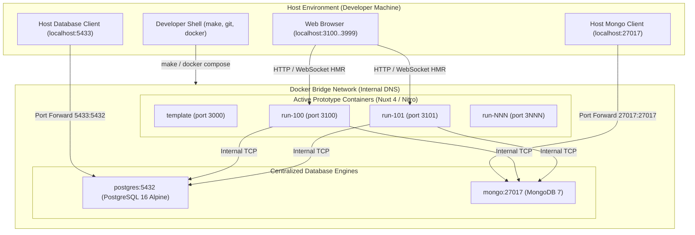

# Container Architecture & Service Topology

This guide explains the orchestration architecture of `tc-proto-docker`. It bridges low-level systems programming concepts (Linux processes, namespaces, and system calls) with Docker Compose service orchestration.

---

## 1. Containers from a Systems Perspective (C/C++ Perspective)

In traditional C and C++ development, an application compiles into a native ELF executable that executes directly in the host user space. Isolation, if desired, is implemented manually using POSIX system calls (`fork()`, `chroot()`, `clone()`, `unshare()`).

A Docker container is **not** a hardware virtual machine (like QEMU or VMware). There is no hypervisor running a separate guest kernel. Instead, a container is **a standard Linux process executing directly on the host kernel**, restricted by two kernel primitives:

1. **Linux Namespaces (Virtualizing System Resources)**:
   - **`pid`**: The container process perceives itself as PID 1, completely isolated from host processes.
   - **`net`**: The container receives its own private loopback interface (`127.0.0.1`), routing table, and virtual ethernet pair (`veth`) attached to a Docker bridge network.
   - **`mnt`**: The container filesystem root (`/`) is decoupled from the host root via `pivot_root`, viewing only container image layers and mounted volumes.
   - **`ipc`**: System V IPC and POSIX message queues/shared memory segments are isolated.
   - **`uts`**: Hostname and domain name are private to the container (e.g. hostname `run-100`).

2. **Control Groups (`cgroups`)**:
   - Kernel subsystems that meter and limit resource consumption (CPU scheduling shares, memory limits, block I/O).

```text
+-------------------------------------------------------------------------+
|                              HOST KERNEL                                |
|  [Namespaces: pid, net, mnt, ipc, uts]  [Control Groups: cpu, memory]   |
+------------------------------------+------------------------------------+
| Docker Bridge Network (tc-proto)   | Host Filesystem                    |
|  +------------------------------+  |  +------------------------------+  |
|  | postgres:5432                |  |  | ./prototypes/run-100/        |  |
|  | mongo:27017                  |  |  | ./docker/postgres/init/      |  |
|  | run-100 (port 3100)          |  |  | .env                         |  |
|  +------------------------------+  |  +------------------------------+  |
+------------------------------------+------------------------------------+
```

---

## 2. Infrastructure Topology

The prototyping platform consists of shared database engines and on-demand Nuxt 4 prototype containers communicating over an internal Docker bridge network:



---

## 3. Service Inheritance (`base-proto`) in Docker Compose

To avoid duplicating 40 lines of container configuration across prototype runs (`run-100` to `run-999`), `docker-compose.yml` uses Docker Compose's `extends:` mechanism.

### The Prototype Blueprint (`base-proto`)

```yaml
services:
  base-proto:
    profiles: ["base"]
    image: node:22-slim
    working_dir: /app
    command: sh -c "corepack enable && pnpm install && pnpm dev --host 0.0.0.0"
    env_file:
      - .env
    volumes:
      - /app/.nuxt
      - type: volume
        source: pnpm_store
        target: /root/.local/share/pnpm/store
        volume:
          subpath: store
    depends_on:
      - postgres
      - mongo
```

- **`image: node:22-slim`**: Uses Debian `glibc` with built-in Corepack to run the exact `packageManager` (`pnpm@12.16.1`) pinned in `package.json`.
- **`env_file: .env`**: Injects global environment variables (database credentials, default hostnames) into the container environment.
- **`volumes`**:
  - `/app/.nuxt`: Anonymous volume masking generated Nuxt build/type caches from the host filesystem.
  - `pnpm_store` (`subpath: store`): Named volume subpath mounting the shared pnpm content-addressable storage at `/root/.local/share/pnpm/store`.
- **`depends_on`**: Ensures database engines are started before prototype containers boot.

### Concrete Prototype Definition

When scaffolding a new run (e.g., `run-100`), the generator appends a minimal definition to `docker-compose.yml`:

```yaml
  run-100:
    extends:
      service: base-proto
    profiles: ["run-100", "all"]
    ports:
      - "3100:3100"
    environment:
      - PORT=3100
      - DB_NAME=proto_run_100
    volumes:
      - ./prototypes/run-100:/app
      - type: volume
        source: pnpm_store
        target: /app/node_modules
        volume:
          subpath: run-100/node_modules
```

This design guarantees that each prototype inherits identical runtime dependencies, environment contracts, and network settings while remaining completely isolated in terms of source code (`./prototypes/run-100`), dependency tree (`subpath: run-100/node_modules` hard-linked to `subpath: store` on the same `pnpm_store` volume), listening port (`3100`), and logical database (`proto_run_100`).

### Storage Initialization Helper (`pnpm-init`)

Because Docker's `volume.subpath` mount option requires target directories inside the named volume to exist beforehand, `docker-compose.yml` includes an internal lifecycle helper:

```yaml
  pnpm-init:
    profiles: ["internal"]
    image: node:22-slim
    volumes:
      - pnpm_store:/pnpm_store
```

It mounts the volume root (no subpaths) and is invoked automatically by the Makefile control plane (`make up`, `make up-all`, `make init`) to provision missing directory structures before any subpath-dependent service container starts.

---

## 4. Compose Profiles for Selective Orchestration

In a repository supporting up to 900 distinct prototypes (`run-100` to `run-999`), starting all containers simultaneously would consume significant system memory (each Node process holding ~100-200MB RSS).

Docker Compose **Profiles** allow selective activation:

1. **Selective Boot**:
   ```bash
   # Starts only postgres, mongo, and run-100
   docker compose --profile run-100 up -d
   # Or via Makefile:
   make up RUN=100
   ```
2. **Global Boot (All Prototypes)**:
   ```bash
   # Starts all prototypes simultaneously
   docker compose --profile all up -d
   # Or via Makefile:
   make up-all
   ```
3. **Template Blueprint Boot**:
   ```bash
   # Starts the template blueprint on port 3000
   make up RUN=template
   ```
Containers that do not match the active profile are ignored by Compose, conserving host CPU cycles and memory.

