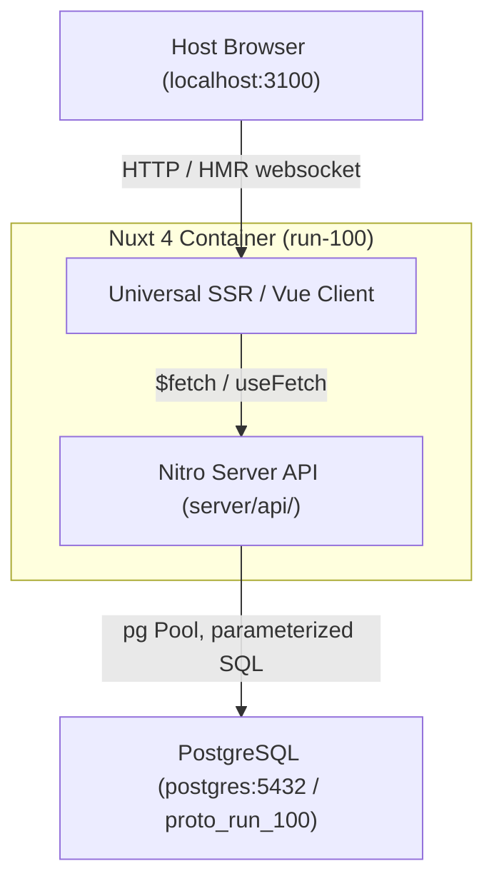

# Design: run-100

## Overview
Baseline Lerch slice (brief: `briefs/run-100.md`): spaces & actors, items with a recursive `parent_id`
hierarchy, one-line creation, and a kanban board plus tree view. Everything is carried vertically:
Vue UI (Nuxt UI + Tailwind) -> Nitro API -> PostgreSQL. The question: can this baseline grow into a
production tool without a rewrite? The answer here is to isolate every future change point
(permissions, ordering, default column, SQL, identity) in one small module.

## System Data Flow

## Architectural Decisions
- **Execution boundaries**: `server/` runs only in Node (DB access, validation, policies). `app/` is universal
  (SSR then hydration); drag-and-drop handlers run only in the browser. `shared/` holds types and constants
  used by both sides.
- **Persistence**: PostgreSQL, tables `spaces`, `actors`, `memberships`, `items` (`parent_id` self-reference).
  Text ids (readable slugs in the seed, UUIDs at runtime).
- **Board columns** are a field on the item (`board_column`) mapped to a state in `shared/utils/columns.ts`.
  Moving a card sets the state, and changing the state moves the card (server-side, `server/utils/items.ts`).
- **Product stubs** live in `server/utils/policies.ts`: `can()`, ordering, default column.
- **Identity**: no auth. The persona id is sent as `x-actor-id`; every item route checks space membership.
- **Trade-offs**: float `position` (cheap midpoint inserts, needs rebalancing eventually); no delete
  (use state `discarded`); board shows every item of the space, not one project's subtree.
