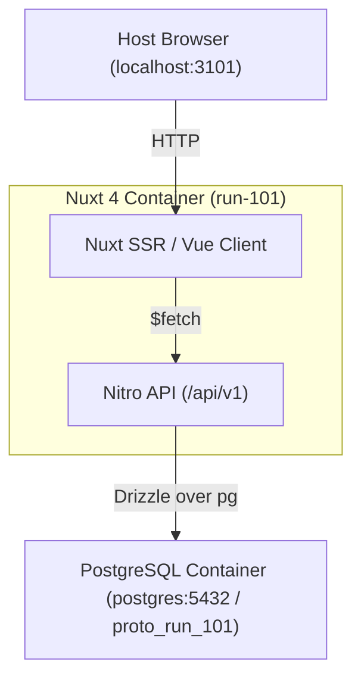

# Design: run-101

## Overview
A backend-first foundation for Lerch: data and APIs are the product, and every interface is a replaceable client.
Features are added as separate modules. The scenario, architecture and task list are in `briefs/run-101.md`.

## System Data Flow



Only the shell and the view registry exist so far. The API and database arrive in tasks 2 to 5.

## Modules
Each folder in `layers/` is a Nuxt layer, merged into the app automatically. Think of each as a library linked into
one binary. Dependencies point one way, and views never import each other:

```text
core ← workspace ← items ← sync ← views (board, tree, details)
```

Nuxt does not enforce this direction: auto-imports let any layer call any other, so it is a team rule.

## Architectural Decisions
- **Execution boundaries**: `layers/*/app` is universal (server render, then browser). `layers/*/server` will be server-only.
- **Views as plug-ins**: a view registers itself from its own plugin. The shell builds its navigation and routes from the registry, so removing a view folder removes it everywhere.
- **Key trade-off**: the registry is fixed at app start. Views chosen per user or space will need a filter on top of it.
