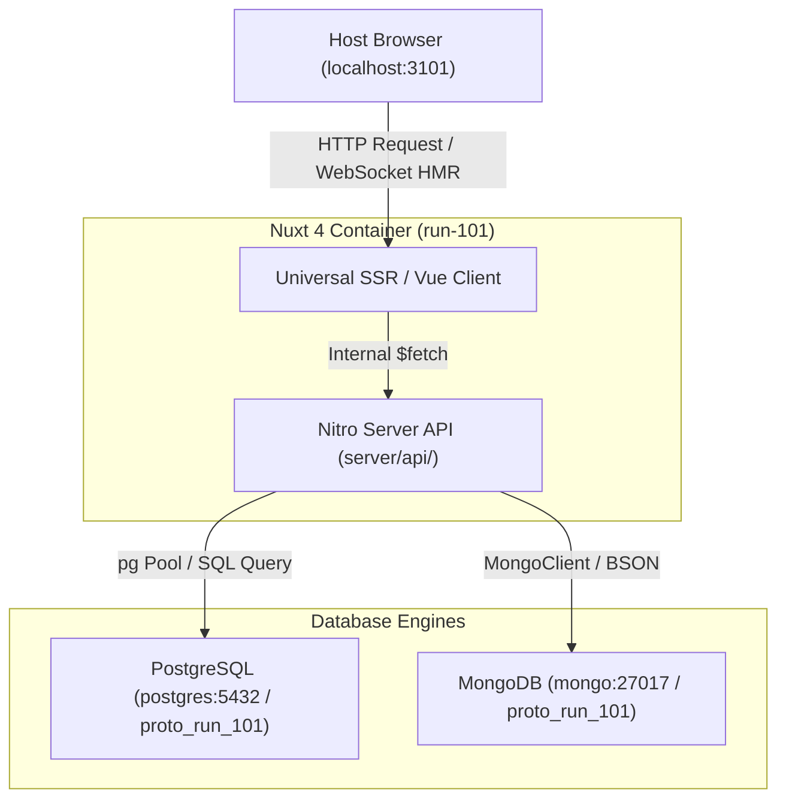

# Design: run-101

## Overview
A brief description of this prototype run, the scenario under evaluation from the assigned brief, and the primary technical questions being answered.

## System Data Flow

## Architectural Decisions
- **Execution Boundaries**: Where specific logic lives (Client-only, Universal SSR, or Server-only Nitro).
- **Persistence Strategy**: Entities stored in PostgreSQL vs. MongoDB.
- **Key Trade-offs**: Trade-offs made in this prototype.

