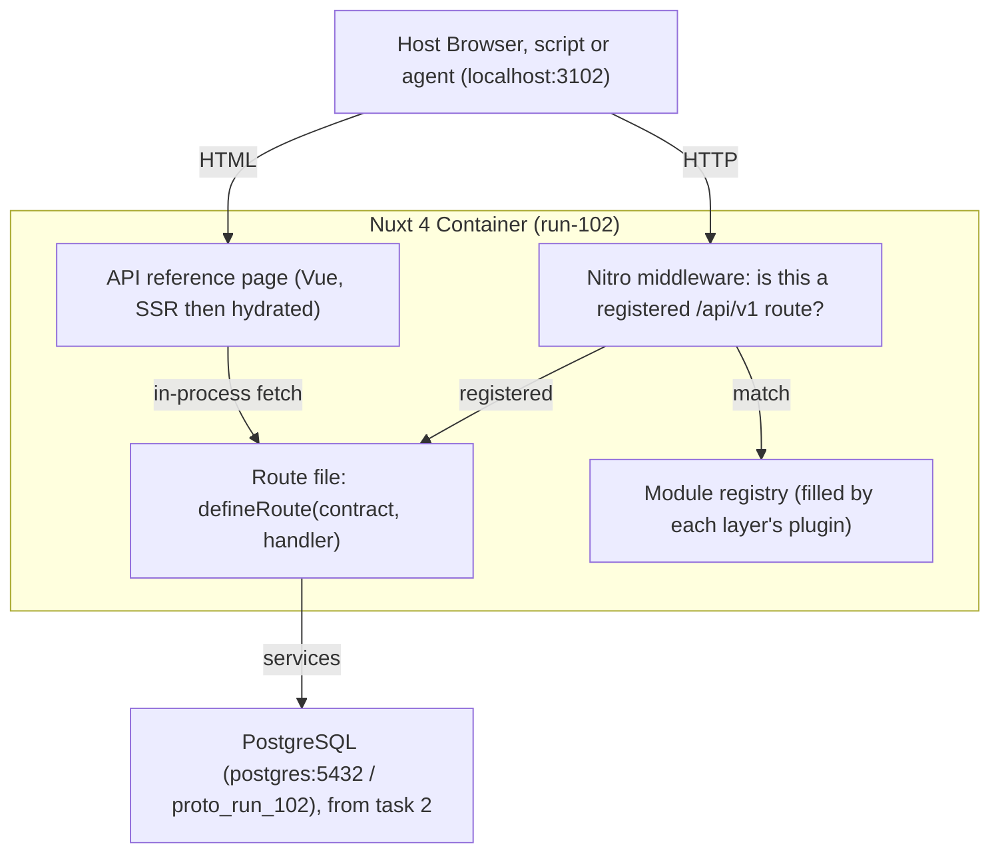

# Design: run-102

## Overview
A backend-first foundation: one versioned `/api/v1` contract, defined once in Zod schemas and built from small Nuxt layers. A browser UI, an agent and a script are equal clients of it. There is no product UI; the only page is a generated API reference.

The question: can later features be added as new layers, with no rename and no change to existing ones? See `briefs/run-102.md`.

## System Data Flow

## Architectural Decisions
- **One contract object per route.** It validates input, checks the response and becomes the OpenAPI entry, so the three cannot drift apart.
- **Layers register themselves.** Each layer has a Nitro plugin that calls `registerModule`. Nothing central lists the layers, and `GET /api/v1` reports what is loaded.
- **The middleware is the front door.** An `/api/v1` request that matches no registered contract gets the shared 404 shape. This also stops a wrong method on a real path from falling through to the page renderer.
- **OpenAPI without an extra package.** Zod 4 produces JSON Schema itself (`target: 'openapi-3.0'`), and `openapi.ts` assembles the document from the contracts.
- **Execution boundaries.** All API code is server-only (Nitro). `app/app.vue` is universal: it runs on the server for SSR, then in the browser.
- **Identity is plugged in, not imported.** `core` runs `getActor()` for every route that needs an actor, but the function lives in `workspace`, which `core` must not import. The workspace layer registers it with a hook at server start.
- **Isolation and policy are separate.** Space membership is enforced by the services; `can()` is a policy stub that allows everything.
- **One writer per space.** Writes take a per-space lock, so the rules (no cycles, version checks, free order keys) are checked against a tree nobody else is changing, and event ids follow commit order.
- **Clients name a neighbour, not a key.** Move takes `after_id` or `before_id`; the server computes the fractional order key, and repairs ties.
- **Keyset pagination.** Lists page by "rows after this (key, id)", not OFFSET, so pages stay stable while data changes. Timestamps travel in cursors as text, because a JavaScript Date would drop microseconds.
- **Persistence.** PostgreSQL only. Each layer owns its tables, one config collects them into one ordered migration history, and the database itself enforces space boundaries, column/state consistency and the append-only log.

## Layers (one-way dependencies)
`core ← workspace ← items ← events`. `core` holds the plumbing (routes, errors, pagination, `can()`); `workspace` owns identity, spaces and columns; `items` owns items; `events` owns its table and has no routes yet.
