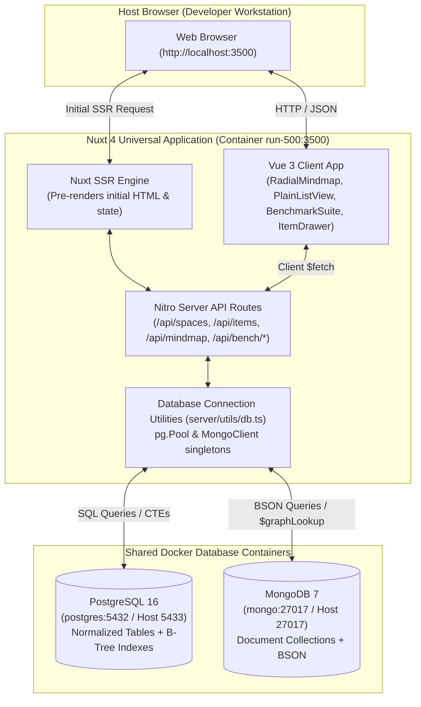

# System Design: run-500

## Overview

Run 500 is an educational exploration designed to teach NoSQL (MongoDB) and relational (PostgreSQL) database mechanics from a systems and C/C++ perspective. It uses Lerch domain items (`Item` + `parent_id` recursive hierarchy) to construct an interactive 360-degree radial mindmap, a plain list view, and a real-time side-by-side benchmark lab.

## Architecture & Data Flow

## Key Architectural Highlights

1. **Dual Storage Engine Synchronization (`DB=hybrid`)**:
   - The same domain concepts (Spaces, Items, Tags) exist in both databases.
   - SQL normalizes tags into an `item_tags` junction table; MongoDB embeds tags directly as a string vector inside the item document.
2. **Radial Mindmap as Domain Hierarchy**:
   - Demonstrates that Lerch's simple `parent_id` model can power complex graph representations without a dedicated graph database.
   - Built with pure SVG curves and responsive math rather than bulky third-party chart libraries.
3. **Live Benchmark Suite**:
   - Enables on-the-fly profiling of 5 core operations: single composite read, deep subtree traversal, grouped status aggregation, tag filtering, and bulk batch insertion.
   - Provides full transparency by exposing raw SQL statements and MongoDB commands directly in the UI.
